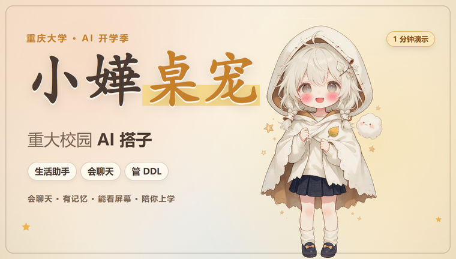

<div align="center">
  
</div>

# 小嬅桌宠

> 住在桌面上的 AI 搭子——会聊天、有记忆、能看屏幕，还帮你管 DDL。

小嬅是一个 Windows 桌面宠物：一个披着桦叶斗篷的小女孩，会自己在桌面上慢慢走、发呆、打哈欠，也会在你敲她脑袋的时候歪头看你。她不是一张会动的壁纸——接上大模型之后，她能记住你说过的事，会在合适的时候主动搭话，能替你看屏幕、管日程。

项目用 **Tauri 2 + Rust** 构建，界面是原生 HTML/CSS/JS，不需要 Node 运行时；安装包约几十 MB，免安装版解压即用。

## 功能

**桌面伙伴**
- 摸头、拖动、拎着晃、拖到屏幕边缘藏起一半、久不理她就会睡着
- 眨眼、张望、小跳、哼歌、偷看你等十几个待机动作，深夜更爱打哈欠
- 每个动作配实时合成的小音效和小女孩的声音，不联网、无音频文件
- 视线跟随、置顶、大小调节、托盘图标、开机自启

**AI 聊天**
- 支持 DeepSeek / 通义千问 / Kimi / 智谱 / 本地 Ollama / 任意 OpenAI 兼容接口
- 漫画对白式的脚边输入条，她始终看得见；也可以打开跟着她走的聊天窗
- 打字机式回复，表情跟着说到的话切换
- 分条记忆：档案（称呼、生日、城市、喜好…）、事实、事件、约定、每日日记，可改可删可导出
- 深度思考模式：换成思考模型，聊天窗里能看她想了什么
- 主动搭话，会回访以前提过的事（"你上次说周五面试，怎么样啦？"）

**让她帮你做事**
- 「十分钟后提醒我喝水」「帮我记一下周五交报告」「打开记事本」「看看我复制了什么」
- 打开网页、运行程序、读写剪贴板之前都会先征求同意，60 秒不回答就当拒绝
- 不会删文件，也不会执行命令

**看屏幕 / 桌面感知**（都默认关闭，可单独开启）
- 看屏幕：截一张图交给视觉模型（推荐免费的智谱 glm-4v-flash），截图只在内存里，用完即丢
- 桌面感知：只读前台窗口的进程名和标题，判断你在写代码 / 看视频 / 开会，不截图、不读内容；会议、游戏、隐私类和全屏时自动安静
- 微信、QQ、密码管理器、网银等程序永远不截

**校园模式**（`v0.7/campus` 分支，开发中）
- DDL 管理：面板「校园」页增删改、按紧急度排序，提前 3 天 / 1 天 / 3 小时 / 1 小时提醒，每天早上汇总
- 每日运势：按日期固定生成，她用自己的语气讲给你听
- 校园新闻：重庆大学新闻网、主页通知公告、研究生院每天最多刷新两次；也支持接入自建 RSS 订阅公众号

**小助手**
- 整点报时（早中晚深夜台词不同）、深夜劝睡、喝水休息提醒
- 天气播报：Open-Meteo 免费数据，每天首次启动和每 3 小时更新，快下雨、降温、极端温度会特别提醒

**换装**
- 5 套日常（原版桦叶 / 晨露奶油 / 焦糖格纹 / 月白星纹 / 星夜斗篷）
- 6 套节日装（春节、情人节 / 七夕、端午、中秋、万圣、圣诞），到日子自动换上
- 7 个配饰槽：头发、脖子、肩上、挂坠、胸口、脸上、头顶
- 跟随时间自动换装：早晨晨露、白天原版、傍晚格纹、夜里月白

## 运行

**直接使用**

到 [Releases](https://github.com/huahuage-hue/xiaohua-desktop-pet/releases) 下载免安装版或安装包，需要 Windows 10/11（系统自带 WebView2）。详细操作见 [使用说明.txt](使用说明.txt)。

**从源码构建**

需要：

- Windows 10/11
- [Rust](https://rustup.rs/)（rustup）
- Visual Studio 生成工具 2022，勾选「使用 C++ 的桌面开发」
- `cargo install tauri-cli --version "^2"`

```powershell
cd desktop-pet
powershell -ExecutionPolicy Bypass -File build.ps1        # 构建并复制到输出目录
powershell -ExecutionPolicy Bypass -File build.ps1 -Dev   # 开发模式，改网页后刷新即可
```

`build.ps1` 会把 `assets/` 里的最新渲染器同步到 `desktop-pet/web/assets`，因此两个目录必须保持在同一层。

## 目录结构

| 路径 | 内容 |
|---|---|
| `desktop-pet/` | 桌宠本体：`src-tauri/` 是 Rust 主程序和开机自启，`web/` 是界面（`pet.html` 桌宠窗、`panel.html` 控制面板） |
| `assets/` | 角色渲染器、分层图集、共用脚本 |
| `docs/` | 角色设计、Live2D 拆件方案、各版本开发计划 |
| `tools/` | 分层图生成、对齐、抠图等设计工具脚本 |
| `psd/` | 角色源文件说明与图层表（PSD 本体和分层原图体积过大，未入库） |
| `index.html` | 浏览器里的角色预览页 |

## 分支

| 分支 | 说明 |
|---|---|
| `master` | v0.6.0 稳定版 |
| `v0.7/campus` | 校园增强（DDL、运势、校园新闻），当前开发分支 |
| `v0.6/chat-ui` | v0.6 聊天界面开发分支 |

## 隐私

- API 密钥只保存在本机（`%APPDATA%\com.xiaohua.desktoppet\chat.json`），面板里只显示末 4 位
- 聊天内容只会发送给你自己选择的模型服务商；不开启对话就什么都不发
- 看屏幕的截图不落盘；桌面感知只在本机判断软件类别
- 天气只向 Open-Meteo 查询城市

## 说明

- 仓库不含视频素材和 PSD 原图，避免仓库体积失控；演示视频、安装包请到 Releases 下载
- 角色设计 © 樺樺嗝，对外发布或商用前请先获得授权
- 代码暂未附带开源许可证，转载请先联系作者
